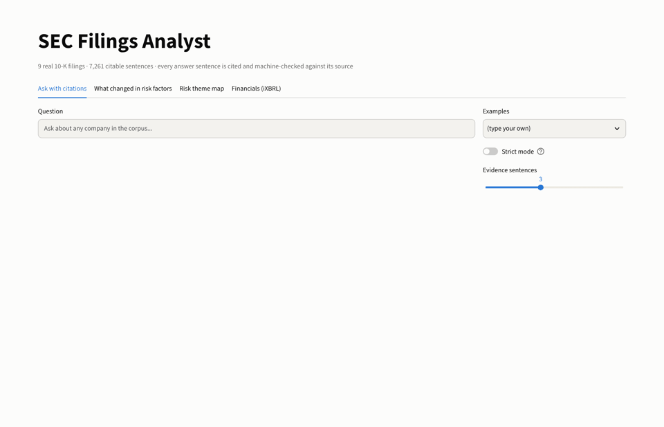
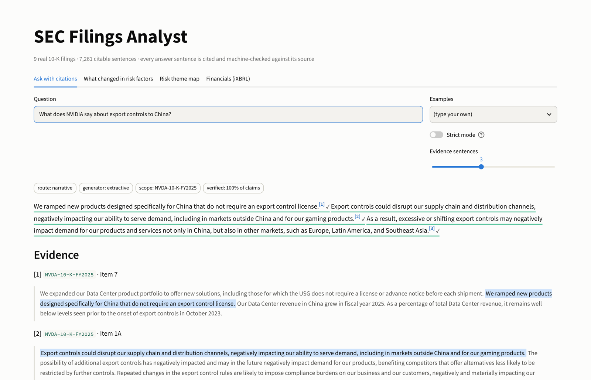
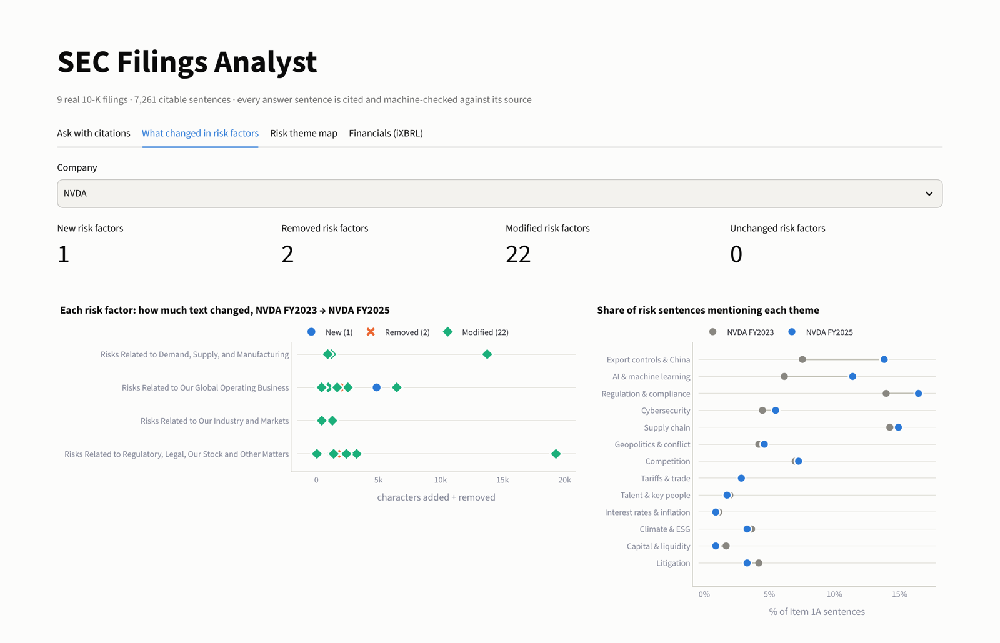
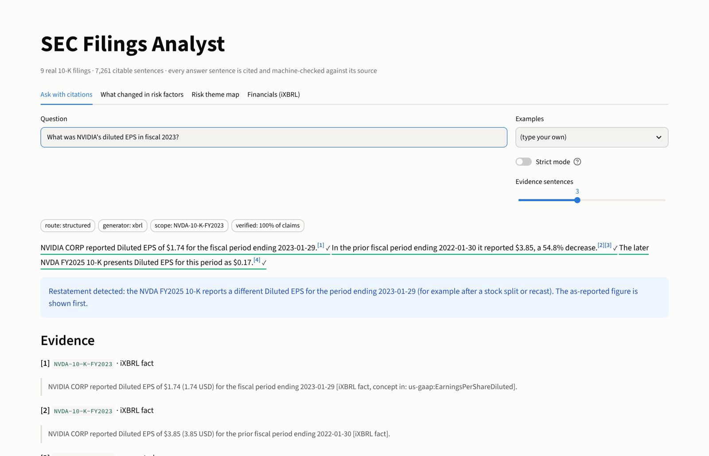
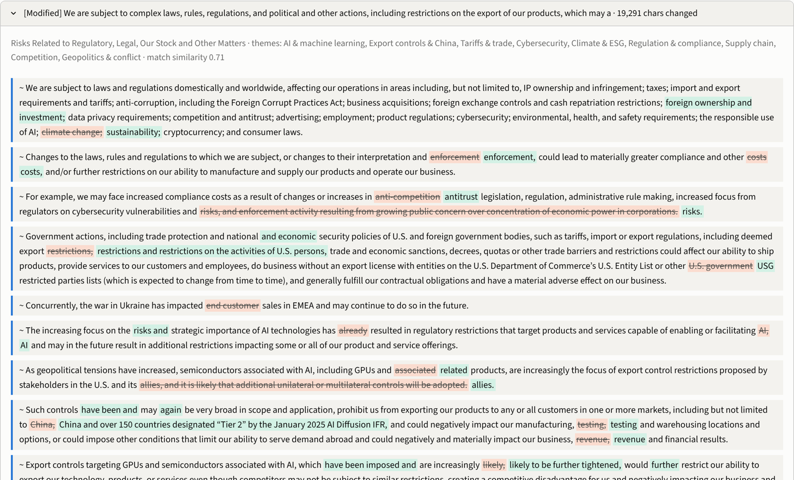
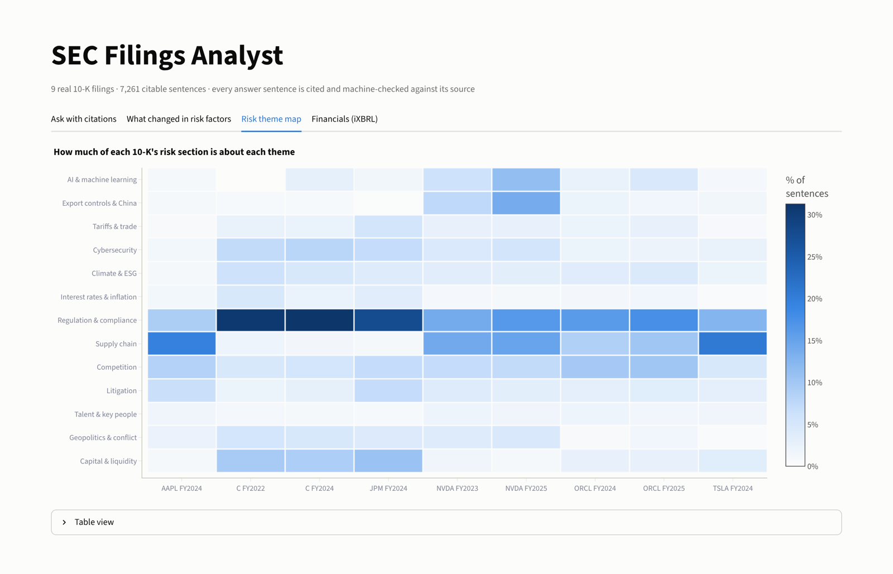
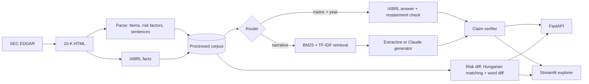

# SEC Filings Analyst

**Ask a question about a company's 10-K and get an answer where every sentence is cited to the filing and automatically checked against its source. Then see exactly what changed in the company's risk disclosures from one year to the next.**

[](https://github.com/juhidixit/sec-filings-analyst/actions/workflows/ci.yml)




Built on 9 real 10-K filings (NVIDIA, Oracle, Citigroup, JPMorgan Chase, Apple, Tesla) with **7,261 citable sentences**, **260 risk factors** and the companies' own iXBRL-tagged financials.

---

## Why this exists

LLM answers about financial documents fail in two expensive ways: they state numbers that are not in the filing, and they cannot show where a claim came from. Analysts also spend hours comparing this year's 10-K with last year's to find the one sentence that was added to a risk factor. This project tackles both:

| Problem | What this project does |
|---|---|
| "Where did that number come from?" | Every answer sentence carries a citation to a specific sentence or iXBRL fact in the filing. |
| Hallucinated or altered facts | A **claim verifier** checks each answer sentence against what it cites and flags wrong numbers, years, entities, reversed direction ("increased" vs "decreased") and inserted negations, with a reason for each flag. A strict mode drops anything it cannot verify. |
| Reading numbers off rendered tables | Metric questions are routed to the filing's **inline XBRL** tags, so the value is exactly what the company reported, with period and concept. |
| Restated numbers | If a later filing reports a different value for the same period (NVIDIA's FY2023 EPS is $1.74 as reported and $0.17 after its 2024 stock split), the answer shows both and says so. |
| "What changed this year?" | Risk factors are matched across years with the Hungarian algorithm, labelled new / removed / modified / unchanged, and diffed at sentence and word level. |

## What it found in the data

These come straight from the corpus (reproduce with `filings-analyst diff NVDA` or the explorer):

* **NVIDIA FY2023 → FY2025:** the share of risk-factor sentences about export controls and China rose from **7.5% to 13.8%**, and about AI from **6.2% to 11.4%**. The FY2025 filing adds language on the "Tier 2" countries in the January 2025 AI Diffusion rule and the EU AI Act. The COVID-19 risk factor and the stand-alone indebtedness risk factor were removed.
* **Citigroup FY2022 → FY2024:** the LIBOR-transition risk factor was removed after the benchmark was retired; the FY2024 filing describes the OCC's finding that Citibank had "failed to make sufficient and sustainable progress" on its 2020 Consent Order and the July 2024 civil money penalty orders.
* **Oracle FY2024 → FY2025:** the TikTok hosting risk (first added after the April 2024 US law) is rewritten for the law taking effect in January 2025 and the executive orders that followed, and new language covers the Ampere investment after SoftBank's announced acquisition.

| Ask with citations | What changed in risk factors |
|---|---|
|  |  |
| **Restatement detection** | **Word-level risk diff** |
|  |  |



## Results

All numbers below are measured by `python eval/run_eval.py` and written to [`eval/results/results.md`](eval/results/results.md). CI re-runs the evaluation on every push and fails if the results drift.

**Retrieval:** 36 hand-written questions, each with a regex the correct evidence sentence must match.

| Retriever | Hit@1 | Hit@3 | Hit@5 | MRR |
|---|---|---|---|---|
| BM25 | 0.806 | 0.917 | 0.944 | 0.863 |
| TF-IDF | 0.833 | 0.861 | 0.917 | 0.861 |
| Hybrid (default) | 0.806 | 0.861 | 0.917 | 0.847 |

Company and fiscal-year scoping picked the right filing for 36/36 questions. Hybrid fusion did not beat BM25 here; the gap is one or two questions, so I kept the default rather than tune it on the test set.

**Claim verification**, where positive means "this claim is not supported by its citation":

| Test set | Method | Precision | Recall | F1 |
|---|---|---|---|---|
| 1,072 synthetic perturbations of real sentences | Lexical-overlap baseline | 1.000 | 0.167 | 0.286 |
| | **This verifier** | **1.000** | **0.994** | **0.997** |
| 30 hand-written paraphrases and subtle errors | **This verifier** | 0.526 | 0.667 | 0.588 |

The synthetic set (wrong number, wrong year, flipped direction, inserted negation, swapped company, wrong evidence, plus faithful controls including unit restatements like "$14.4 billion" → "$14,400 million") shows the checks do what they claim. The hand-written set is the honest stress test, and it shows the limit of a symbolic verifier: it flags faithful paraphrases and misses errors that need reasoning (see [limitations](docs/model_card.md#known-limitations)).

**Numeric questions:** 171 questions (57 facts × 3 phrasings) such as "How much revenue did Apple report for 2024?"

| Method | Correct |
|---|---|
| Retrieval only (answer appears in top-3 sentences) | 0.035 |
| iXBRL routing | 1.000 |

## Architecture



More detail and the reasoning behind each design choice: [`docs/architecture.md`](docs/architecture.md).

## Quickstart

```bash
git clone https://github.com/juhidixit/sec-filings-analyst && cd sec-filings-analyst
python -m venv .venv && source .venv/bin/activate
make install            # pip install -e ".[app,llm,dev]"

make app                # Streamlit explorer at http://localhost:8501
make api                # FastAPI at http://localhost:8000/docs
make test               # 40 tests
make eval               # reproduce eval/results/results.md
```

The processed corpus is committed, so everything above works offline with no API key.

**Command line**

```bash
$ filings-analyst ask "What was NVIDIA's diluted EPS in fiscal 2023?"
NVIDIA CORP reported Diluted EPS of $1.74 for the fiscal period ending 2023-01-29 [1]. In the prior
fiscal period ending 2022-01-30 it reported $3.85 [2], a 54.8% decrease [3]. The later NVDA FY2025
10-K presents Diluted EPS for this period as $0.17 [4].

$ filings-analyst diff NVDA
NVDA FY2023 -> NVDA FY2025: {'new': 1, 'removed': 2, 'modified': 22, 'unchanged': 0}

$ filings-analyst ask --strict "What does Citi say about its consent orders?"
```

**API**

```bash
curl -s localhost:8000/ask -H 'content-type: application/json' \
  -d '{"question": "What would happen if Oracle can no longer host TikTok?", "strict": true}'
```

Endpoints: `GET /health`, `GET /filings`, `GET /filings/{doc_id}/financials`, `POST /ask`, `GET /diff/{ticker}`.

**Docker**

```bash
docker compose up --build   # API on :8000, explorer on :8501
```

**Use Claude as the generator (optional).** `export ANTHROPIC_API_KEY=...` and answers become abstractive, written only from the numbered evidence. The verifier checks them the same way, and `--strict` removes anything it cannot support.

**Add more companies.** SEC requires a contact in the User-Agent:

```bash
export SEC_USER_AGENT="Your Name your.email@example.com"
filings-analyst fetch MSFT AMZN --limit 2   # download the latest two 10-Ks each
filings-analyst build                        # parse into data/processed
make data                                    # or re-download this repo's exact 9 filings
```

## Project layout

```
src/filings_analyst/
  edgar.py      polite EDGAR client (User-Agent, rate limit, retries)
  parse.py      HTML -> blocks with emphasis flags -> 10-K Items
  risk.py       Item 1A -> individual risk factors
  xbrl.py       inline XBRL facts -> headline financials
  corpus.py     processed filing format (sentences with stable IDs)
  retrieve.py   BM25 + TF-IDF hybrid, company/year scoping
  answer.py     router, iXBRL answers, restatement check, generators
  verify.py     claim verifier
  diff.py       risk-factor matching, sentence and word diffs, themes
  api.py, cli.py
app/            Streamlit explorer
eval/           evaluation harness, hand-written question and claim sets, results
tests/          40 unit, integration and API tests
```

## Limitations and next steps

The full list is in the [model card](docs/model_card.md). The most important: the symbolic verifier is a precise tripwire for numeric, entity and direction errors but is weak on paraphrase. Next steps, in order:

1. Add an NLI cross-encoder (or an LLM judge) as a second verification stage for claims the rules cannot decide, and measure it on the hand-written set.
2. Add dense retrieval and re-ranking, and grow the QA set beyond 36 questions so retrieval differences are statistically meaningful.
3. Extend to 10-Q filings and parse bank MD&A from the annual-report exhibit.

## Data and license

Code is MIT licensed. SEC filings are public records. The nine HTML filings used to build the committed corpus came from the test fixtures of the MIT-licensed [edgartools](https://github.com/dgunning/edgartools) project, which are verbatim copies of EDGAR documents; `make data` downloads the same filings from SEC EDGAR directly. Not investment advice.
