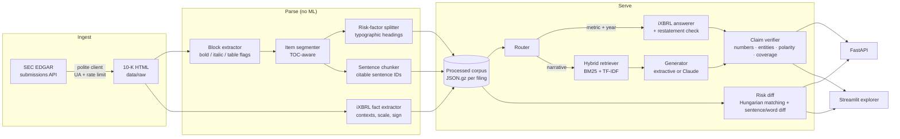

# Architecture

## Design decisions

| Decision | Why |
|---|---|
| Parse with typography, not a model | 10-K risk headings are always bold or italic. A deterministic parser is fast (≈1 s for a 22 MB Citi filing), debuggable, and never hallucinates a heading. |
| Pick the *longest* span per Item | Every Item heading appears in the table of contents and in page headers. The body occurrence is the one followed by the most prose. |
| Read financials from iXBRL, not tables | Every number in a 10-K financial statement is tagged with a concept, period and scale. Reading the tag is exact; reading a rendered table is not. |
| Route metric questions to iXBRL | Retrieval alone put the right number in the top-3 sentences for 3.5% of 171 numeric questions; the iXBRL route answers 100% (see `eval/results/results.md`). |
| Prefer the as-reported filing, then check later filings | NVIDIA's FY2023 diluted EPS is $1.74 in its FY2023 10-K and $0.17 in its FY2025 10-K (10-for-1 split). Both are true; the system shows the first and flags the second. |
| Cite sentences, not chunks | A reviewer should be able to check a claim by reading one highlighted sentence. |
| Symbolic verifier first | Every flag comes with a human-readable reason, runs in microseconds, and needs no GPU or API key. Its weakness (paraphrase) is measured, not hidden. |
| Hungarian matching for risk diffs | Issuers reorder and retitle risk factors every year. Optimal one-to-one matching on TF-IDF similarity is stable under reordering, unlike greedy matching. |
| Edits vs. adds/removes | A sentence that changes "two suppliers" to "three suppliers" is shown as a word-level edit, not as one deleted and one inserted sentence. |
